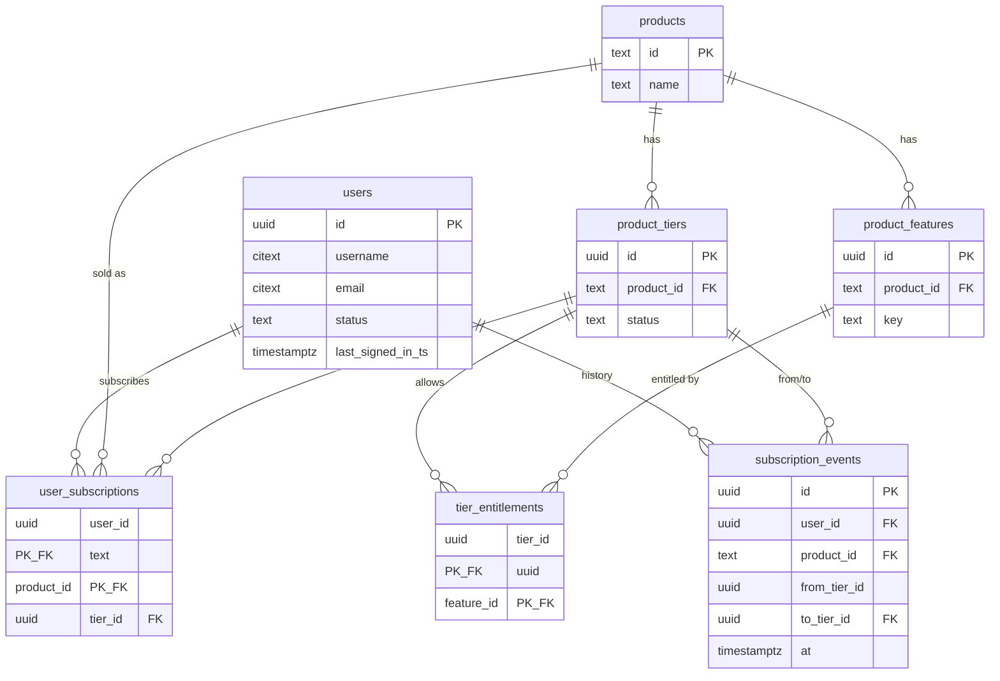
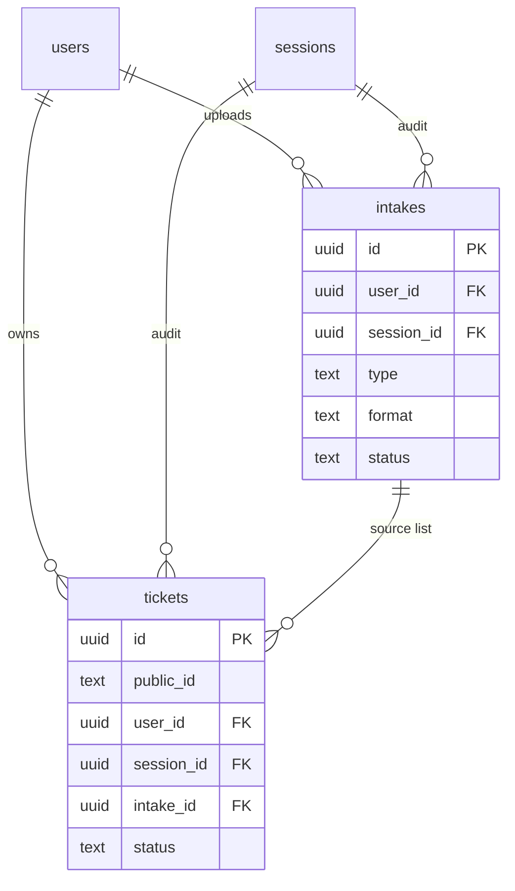

# Netpalm product subscription ERD

Yes. The diagram below is the entity-relationship diagram for Netpalm.ai products, per-product tiers, and feature entitlements.

`users` is identity only. Product, tier, and entitlements are catalog tables. A user’s access is a row in `user_subscriptions`. Do not store `registered_product` or `subscription_status` on `users`.

## Tables

- `products` — Netpalm products. `fleetai` is one row.
- `product_tiers` — unique `(product_id, status)`. Each product has its own tier names.
- `product_features` — unique `(product_id, key)`. Features belong to a product.
- `tier_entitlements` — which features that product-tier turns on.
- `user_subscriptions` — unique `(user_id, product_id)`. One subscription per user per product, pointing at that product’s tier.

Runtime entitlements: join `user_subscriptions` → `product_tiers` → `tier_entitlements`. Do not copy a feature list onto the user.

## Intakes and tickets

Each upload is a row in `intakes`. Parsed defects are `tickets`. A new upload of the same `type` for that user inserts a row and sets the previous row `status = deactivated`. Bytes live on disk under `tickets/intakes/<uuid>`; Postgres stores metadata and sha256.

`intakes.type` is `email_desc`, `ticket_list`, or `project_context`. `intakes.format` is `txt`, `pdf`, or `md`. Paste vs PDF is the same type with a different format. `intakes.status` is `active` or `deactivated`. `tickets.status` stays `unresolved`, `verifying`, `completed`, or `fixed`. `tickets.public_id` is the parser id. `session_id` is audit only; ownership is `user_id`.

## Example shape (FleetAI)

| product | tier | entitled features |
|---|---|---|
| `fleetai` | `free` | `tickets` |
| `fleetai` | `trial` | `tickets` |
| `fleetai` | `paid` | `tickets` |

Signup for FleetAI inserts `user_subscriptions (user, fleetai, free)`. A plan change updates `tier_id` on that row. Another Netpalm product is another `products` row and another `user_subscriptions` row, not another column on `users`.

FleetAI is seeded in `backend/migrations/001_auth.sql`: product `fleetai`, tiers `free` / `trial` / `paid`, feature `tickets` on every tier. Ticket and job APIs require that entitlement. A password_hash update revokes all sessions for that user. `tier_entitlements` includes `product_id` so a feature cannot be attached to another product’s tier. Subscription tier changes are appended to `subscription_events`. The API pool uses role `fleetai_runtime` (DML only).
